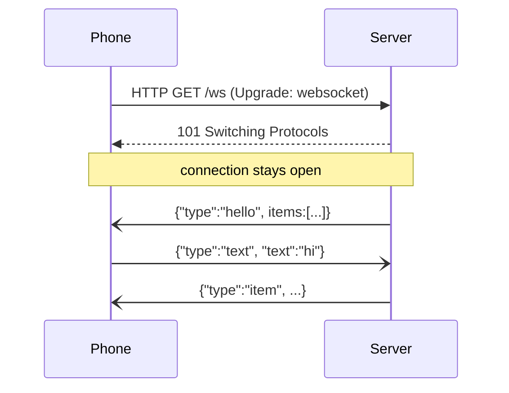
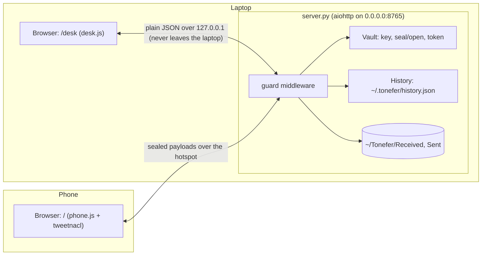
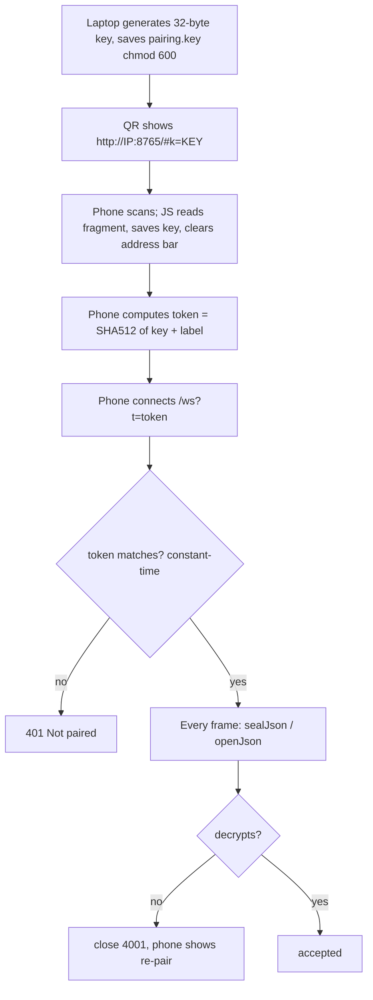
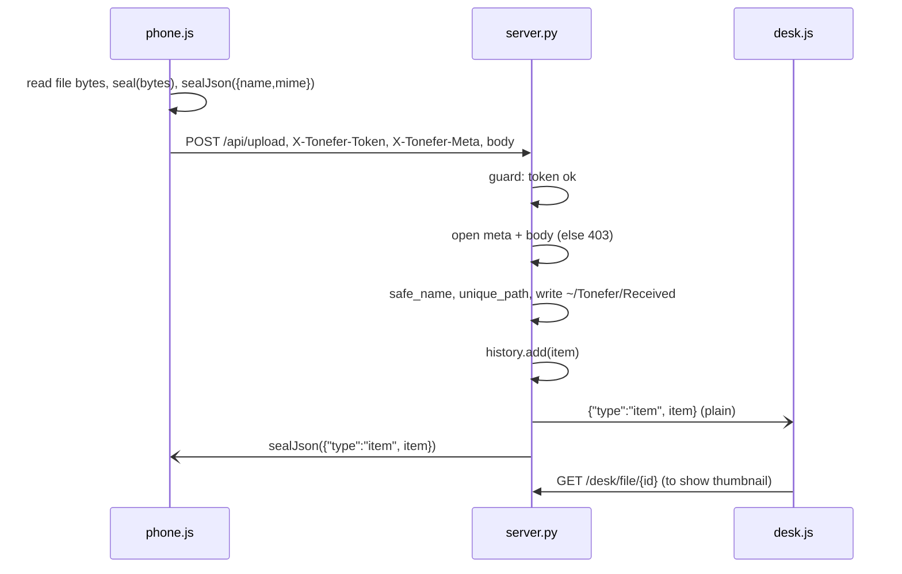
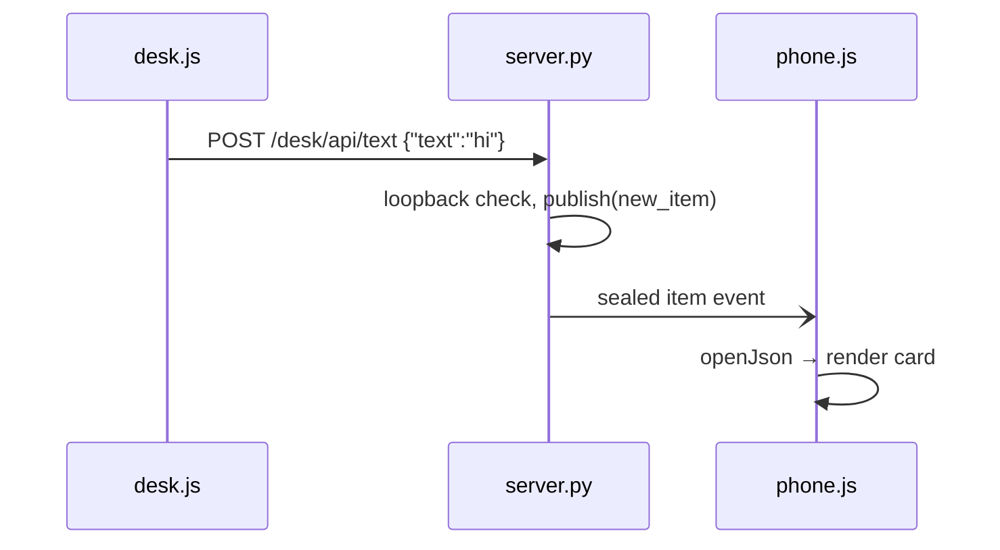

# tonefer: the complete guide

For someone who knows **HTML, CSS, JavaScript and Python**. The code here is Python and plain JavaScript, so the languages
are familiar. What is new: **networking** (IP addresses, hotspots, WebSockets), **async Python** (aiohttp) and
**cryptography** (encryption keys, nonces, authenticated encryption). This guide teaches each from zero.

---

## Table of contents

1. [The project in one minute](#1-the-project-in-one-minute)
2. [Concepts explained from zero](#2-concepts-explained-from-zero)
3. [Architecture](#3-architecture)
4. [The security design](#4-the-security-design)
5. [File-by-file tour](#5-file-by-file-tour)
6. [Main flows with diagrams](#6-main-flows-with-diagrams)
7. [Decisions and why](#7-decisions-and-why)
8. [Honest weaknesses and fixes](#8-honest-weaknesses-and-fixes)
9. [Build it yourself from scratch](#9-build-it-yourself-from-scratch)
10. [Change requests you might get](#10-change-requests-you-might-get)
11. [Interview and recruiter questions](#11-interview-and-recruiter-questions)
12. [Glossary](#12-glossary)
13. [Self-check exercises](#13-self-check-exercises)

---

## 1. The project in one minute

**Problem:** Moving a photo from phone to laptop usually means WhatsApp-to-self, email or a cloud drive. That uses internet,
compresses images, and puts private files on someone else's server.

**Solution:** Turn on the phone's hotspot, connect the laptop to it, run `./run.sh`. The laptop shows a QR code. Scan it once.
Now both devices share one timeline: send text, photos and files either way, directly over that local link, encrypted.

**Elevator pitch:**

> "tonefer is a local-first, end-to-end encrypted file and message bridge between a phone and a laptop. The laptop runs an
> async Python server with aiohttp and WebSockets. Pairing is a QR code that carries a 256-bit key in the URL fragment,
> so it never reaches any server log. Every payload is sealed with NaCl secretbox, and the laptop-only UI is locked to
> loopback with a Host-header check against DNS rebinding."

---

## 2. Concepts explained from zero

### 2.1 IP addresses, LAN and hotspot

Every device on a network has an **IP address** like `192.168.43.12`. When your phone makes a hotspot, it creates a small
**local area network (LAN)**: the phone and the laptop can reach each other by IP without the internet.

- `127.0.0.1` (also `localhost`, `::1`) is **loopback**: "this same computer". Only programs on the laptop can use it.
- `0.0.0.0` when starting a server means "listen on every network interface", so both loopback and the hotspot IP work.
- A **port** (8765 here) is like a door number on the computer, so several servers can run at once.

`lan_addresses()` in `server.py` uses `psutil` to list the laptop's network interfaces, skips loopback, Docker and VM adapters,
and ranks `192.168.*` and `10.*` first because hotspots usually use those.

### 2.2 HTTP vs WebSocket

**HTTP** is request/response: the client asks, the server answers, done. Good for uploads and downloads.
A **WebSocket** is a connection that stays open so **both sides can send messages at any time**. Perfect for chat:
when the laptop sends a message, the server pushes it to the phone instantly, without the phone asking.



`heartbeat=20` makes aiohttp ping every 20 seconds so dead connections are detected.

### 2.3 Async Python and aiohttp

Normal Python runs one thing at a time: while waiting for a network read, it does nothing else. **`asyncio`** lets one program
juggle many waits: when one task waits (`await`), another runs. It is exactly like JavaScript's `async/await` and event loop.

**aiohttp** is an async web framework (like Flask, but async). It is chosen here because it handles HTTP and WebSockets in one
small package and can hold many open WebSockets cheaply.

```python
async def phone_ping(self, request):
    return web.json_response({"ok": True})      # a route handler
r.add_get("/api/ping", self.phone_ping)          # like @app.route in Flask
```

`asyncio.to_thread(path.read_bytes)` runs a slow, blocking job (reading a big file, encrypting it) in a background thread so
the event loop is not frozen.

### 2.4 Middleware

A function that runs **before every request**. `guard` here decides who may enter:

- `/desk...` → only from this computer.
- `/api...` and `/ws` → only with the right token.
- Everything → adds security headers (`no-store`, `nosniff`, `no-referrer`).

### 2.5 Encryption basics

- **Plaintext:** the readable data. **Ciphertext:** the scrambled data.
- **Symmetric key:** one secret key that both encrypts and decrypts. Both devices must have it. Here it is 32 random bytes (256 bits).
- **Nonce:** "number used once". A random 24-byte value mixed in each time, so encrypting the same message twice gives different ciphertext. It is not secret; it is sent in front of the ciphertext.
- **Authenticated encryption:** besides hiding data, it adds a tag that proves it was not changed. If anyone flips one bit, decryption fails. That is the "Poly1305" part.

**NaCl `secretbox`** (XSalsa20-Poly1305) does all of this in one call. PyNaCl (Python) and tweetnacl (JavaScript) implement the same thing, so the phone and laptop understand each other.

```
seal(data)  = nonce (24 random bytes) + secretbox(data, nonce, key)
open(blob)  = secretbox_open(blob[24:], blob[:24], key)   # fails if key wrong or data changed
```

**Why not just use HTTPS?** HTTPS needs a certificate for a domain name. On a hotspot there is no domain and no internet, so
browsers would show scary warnings. Encrypting the payloads ourselves gives confidentiality without certificates.

### 2.6 Hashes and tokens

A **hash** (SHA-512) turns any input into a fixed-length fingerprint; you cannot reverse it. The **token** is
`SHA-512(key + "tonefer-auth")`, first 64 hex characters. It proves "I am paired" without sending the key itself.
It is only a gate; real protection is that payloads must decrypt.

`hmac.compare_digest` compares strings in **constant time**, so an attacker cannot guess the token character by character
by measuring how long the comparison takes (a **timing attack**).

### 2.7 The URL fragment

In `http://192.168.43.12:8765/#k=abc...`, everything after `#` is the **fragment**. Browsers **never send it to the server**;
it stays in the page for JavaScript to read. So the key appears in no server log or network request. `phone.js` reads it, saves it
to `localStorage`, then removes it from the address bar with `history.replaceState`.

### 2.8 QR codes

A QR code is just text drawn as squares. The server creates an SVG QR of the pairing URL with the `qrcode` library. The phone camera opens the URL.

### 2.9 Base64

Encrypted data is raw bytes. WebSocket text frames and HTTP headers need text, so bytes are converted with **base64**
(64 safe characters). `base64url` swaps `+/` for `-_` so it is safe inside URLs.

---

## 3. Architecture



**Two different trust zones:**

- The **laptop browser** talks over loopback, which never leaves the machine, so it uses plain JSON.
- The **phone** talks over the hotspot, which others on the hotspot could listen to, so everything is sealed.

The server is the hub. When anything new arrives, `broadcast()` sends it to every open laptop socket (plain) and every phone socket (sealed).

### Routes

| Path | Who | What |
|------|-----|------|
| `GET /` | phone | phone page |
| `WS /ws?t=` | phone | encrypted event stream |
| `GET /api/ping` | phone | "am I still paired?" |
| `POST /api/upload` | phone | sealed file + sealed meta header |
| `GET /api/file/{id}` | phone | sealed file download |
| `GET /desk` | laptop | laptop page |
| `WS /desk/ws` | laptop | plain event stream + presence |
| `POST /desk/api/text` | laptop | send a message |
| `POST /desk/api/upload` | laptop | multipart upload (drag and drop) |
| `GET /desk/file/{id}` | laptop | open or download a file |
| `GET /desk/api/pair` | laptop | QR SVG + IP choices |
| `POST /desk/api/repair` | laptop | new key, kick all phones |
| `POST /desk/api/delete/{id}`, `/clear`, `/open-folder` | laptop | housekeeping |
| `/static/*` | both | CSS, JS, tweetnacl |

---

## 4. The security design



**Threats it handles:**

| Threat | Defence |
|--------|---------|
| Someone on the hotspot sniffs traffic | All payloads are encrypted |
| Someone tampers with a message | Poly1305 tag fails, rejected |
| Stranger opens the phone page | No key → no token → 401, and nothing decrypts |
| Another device opens `/desk` | Loopback-only check |
| DNS rebinding (an evil site pointing its domain to 127.0.0.1) | `Host` header must be localhost |
| Path traversal (`../../.bashrc` as a file name) | `safe_name` keeps only the base name and strips bad characters |
| Overwriting files | `unique_path` adds `(1)`, `(2)` |
| Huge uploads | `MAX_FILE` 512 MB and `client_max_size` |
| Lost phone | "Unpair all phones" rotates the key and closes sockets with 4001 |
| Local file paths leaking | `History.public` removes `path` |

**Known limitation (written in the README):** the phone page's JavaScript itself is served over plain HTTP. An attacker
already on your hotspot could modify that JS in transit. A native Android app would fix this because the code ships inside the app.

---

## 5. File-by-file tour

### `server.py`

- **Config at the top:** `APP_DIR`, `FILES_DIR`, `PORT` from environment variables with defaults. `MAX_FILE` = 512 MB.
- **`Vault`:** loads or creates the key. `rotate()` makes a new one (that is "unpair"). `seal`, `open`, `seal_json`, `open_json`, `token`, `key_b64`.
- **`History`:** a list of item dicts saved to JSON. `save()` writes to a `.tmp` file then `replace()`s it. This is an **atomic write**: if the laptop crashes mid-write, the old file is still intact.
- **`new_item`:** 16-hex id, kind, origin, timestamp in milliseconds (JavaScript-friendly).
- **`safe_name`, `unique_path`:** file name safety.
- **`lan_addresses`:** find reachable IPs.
- **`Tonefer` class:** holds the vault, history and two sets of open sockets (`phones`, `desks`).
  - `broadcast`, `announce_presence` ("1 phone connected"), `publish` (save + broadcast), `store_file`.
  - `guard` middleware.
  - Phone handlers and desk handlers (see routes table).
  - `build()` wires the routes.
- **`main()`:** prints the URLs, opens the browser 0.6 s after start (unless `--no-browser`), runs the app on `0.0.0.0`.

### `web/static/common.js`

Shared UI helpers exported as `window.T`: inline SVG `ICONS`, `esc` (XSS escaping), `linkify` (escape first, then turn URLs into links,
the safe order), `size` (bytes to KB/MB), `dayLabel` (Today / Yesterday), `copyText` (Clipboard API with a fallback for
plain-HTTP pages, where `navigator.clipboard` is blocked), `toast`, `renderTimeline` and `card`.

### `web/static/phone.js`

- base64 helpers, `seal/open` with tweetnacl, `setKey` computes the token.
- `loadKey`: from `#k=` (then saved) or from `localStorage`.
- `fetchFile`: downloads sealed bytes, decrypts, turns them into a `Blob` URL for images and downloads. Cached in a `Map`.
- `connect`: opens the WebSocket, handles `hello`, `item`, `deleted`, `cleared`; on close code `4001` it unpairs; otherwise reconnects.
- `upload`: seals the file bytes and the meta JSON, POSTs to `/api/upload`.

### `web/static/desk.js`

Same timeline, plain JSON. QR panel (`loadPair` with an IP picker), drag-and-drop and paste upload via `FormData`, delete, clear, unpair, open folder, image viewer.

### `web/desk/index.html`, `web/phone/index.html`, `web/static/tonefer.css`

Markup and styles. `manifest.json` lets the phone add it to the home screen.

### `run.sh`, `run.bat`

First run: create `.venv`, install requirements. Then start. `exec` replaces the shell with Python so Ctrl+C stops it cleanly.

### `docs/PROTOCOL.md`

The contract between phone and laptop, so a future Android app can be written in Kotlin without reading the Python.

---

## 6. Main flows with diagrams

### Phone sends a photo



### Laptop sends a message



---

## 7. Decisions and why

| Decision | Why | Trade-off |
|----------|-----|-----------|
| Hotspot, no internet | Private, free, works anywhere | Both devices must be on the same link |
| Web page on the phone (not an app yet) | Zero install, ship fast | JS served over HTTP (see limitation) |
| aiohttp | Async, HTTP + WebSocket in one small lib | Less known than Flask/FastAPI |
| NaCl secretbox | Simple, safe defaults, same in Python and JS | Must manage keys yourself |
| Key in URL fragment | Never sent over the network in a request | Anyone who sees the QR can pair |
| Token + encryption | Token blocks strangers early; encryption is the real lock | Two mechanisms to explain |
| JSON file history | No database to install | Not great for thousands of items |
| Files saved as normal files | Easy to find in a file manager | Deleting from the timeline does not delete the file |
| Vendored tweetnacl | Works offline, no CDN | Must update manually |

---

## 8. Honest weaknesses and fixes

1. **Phone JS served over HTTP** (documented). *Fix:* native app, or pin a hash of the JS.
2. **Desk endpoints have no CSRF protection.** A malicious website open in the laptop's browser could send a `POST` to
   `http://127.0.0.1:8765/desk/api/clear` (the request comes from loopback with a localhost Host header, so the guard allows it).
   *Fix:* in `guard`, for `/desk` POSTs require the `Origin` header to be `http://127.0.0.1:PORT` or `http://localhost:PORT`, or require a random per-session token in a header.
3. **Whole file in memory.** Uploads and downloads read the full file into RAM (fine for photos, heavy for 500 MB videos). *Fix:* stream in chunks with per-chunk sealing.
4. **No tests.** *Fix:* pytest tests for `safe_name`, `Vault` round-trip, and the guard.
5. **History grows forever.** *Fix:* cap or paginate.
6. **One shared key for all phones.** Unpairing one means unpairing all. *Fix:* per-device keys.

Raising number 2 yourself in an interview shows real security understanding.

---

## 9. Build it yourself from scratch

1. **Hello aiohttp:** one route returning "hi". Run on `0.0.0.0`, open it from your phone on the hotspot using the laptop's IP.
2. **Static files:** serve an HTML page and a JS file.
3. **WebSocket chat (no crypto):** phone and laptop both open `/ws`; server keeps a set of sockets and broadcasts.
4. **History:** save messages to a JSON file; send all on connect (`hello`).
5. **File upload:** laptop with `multipart`, phone with `fetch` + raw body. Save with `safe_name`.
6. **Encryption:** `pip install pynacl`. Round-trip in Python first. Then add tweetnacl to the phone page and prove Python can open what JS sealed.
7. **Pairing:** generate key, QR with the fragment, phone reads `location.hash`.
8. **Guard middleware:** token check, loopback check, Host check.
9. **Polish:** presence, unpair, image thumbnails with Blob URLs, copy button.

Time: 3 to 4 weekends. Step 6 is the hardest; take it slowly.

---

## 10. Change requests you might get

### "Show who is connected."

Already there: `announce_presence` sends the phone count to desks. To show names, have the phone send `{type:"hello", name}` after connect and keep a dict.

### "Delete the file from disk when deleted from the timeline."

In `desk_delete`, after `history.remove`, if `item["kind"] == "file"`: `(FILES_DIR / item["path"]).unlink(missing_ok=True)`.

### "Add a CSRF fix."

```python
if request.path.startswith("/desk") and request.method != "GET":
    origin = request.headers.get("Origin", "")
    if origin not in (f"http://127.0.0.1:{PORT}", f"http://localhost:{PORT}"):
        raise web.HTTPForbidden(text="Bad origin")
```

### "Change the default port."

`TONEFER_PORT=9000 ./run.sh`, or change the default in `PORT = int(os.environ.get("TONEFER_PORT", "8765"))`.

### "Add clipboard sync."

Phone sends `{type:"clip", text}`; laptop uses `pyperclip` to set the clipboard. Mention the privacy consideration.

### "Limit file size to 50 MB."

Change `MAX_FILE = 50 * 1024 * 1024`. Both the upload checks and `client_max_size` use it.

---

## 11. Interview and recruiter questions

**Q: How does pairing work?** The laptop generates a 256-bit key, shows a QR with the key in the URL fragment. The phone reads it with JavaScript; fragments are never sent to servers. The phone derives a token from the key for access, and seals every payload with the key.

**Q: What encryption and why?** NaCl secretbox: XSalsa20 stream cipher plus Poly1305 MAC. It is authenticated encryption, so it gives both secrecy and tamper detection, and it is available identically in Python and JavaScript.

**Q: What is a nonce and why random?** A value used once per encryption so the same plaintext never produces the same ciphertext. XSalsa20's 24-byte nonce is big enough to choose randomly with no realistic chance of repeats.

**Q: Why WebSockets?** Two-way, real-time pushes without polling.

**Q: What is DNS rebinding and how do you block it?** An attacker's domain first resolves to their server, then to 127.0.0.1, so their page can call your local server as "same origin". Checking that the `Host` header is `localhost`/`127.0.0.1` blocks it, because the browser sends the attacker's domain name as the Host.

**Q: Why async?** Many open WebSockets and slow file I/O. Async lets one process handle them without one thread per connection. Heavy work goes to `asyncio.to_thread`.

**Q: How do you stop path traversal?** `safe_name` keeps only the final path component and strips reserved characters; `unique_path` avoids overwriting.

**Q: What would you improve?** CSRF origin check on desk POSTs, streaming large files, per-device keys, tests, and the native Android app.

**Q: Why not just use HTTPS?** No domain and no internet on a hotspot, so no trusted certificate. Self-signed certs give browser warnings. Payload encryption avoids that, with the honest caveat about the JS delivery.

---

## 12. Glossary

| Word | Meaning |
|------|---------|
| aiohttp | Async Python web framework |
| asyncio | Python's event loop for async code |
| Atomic write | Write to temp then rename, so the file is never half-written |
| Authenticated encryption | Encryption that also detects tampering |
| Base64 | Text encoding for binary data |
| CSRF | A website tricking your browser into sending a request to another site |
| DNS rebinding | Attack that makes a hostile domain point to your local machine |
| Fragment | The part of a URL after `#`, never sent to servers |
| Hash | One-way fingerprint of data |
| Loopback | 127.0.0.1, the machine itself |
| Middleware | Code that runs before every request |
| Nonce | A number used once in encryption |
| Path traversal | Using `../` in a name to escape a folder |
| Symmetric key | One key that both encrypts and decrypts |
| WebSocket | Long-lived two-way connection |

---

## 13. Self-check exercises

1. Draw the pairing flow from memory.
2. Explain why the token alone would not be enough security.
3. Write a Python snippet: seal "hello" with PyNaCl and open it again; then flip one byte and watch it fail.
4. Add the Origin check from section 10 and test it with `curl -X POST -H "Origin: http://evil.com" http://127.0.0.1:8765/desk/api/clear`.
5. Add a pytest test for `safe_name("../../etc/passwd")`.

---

## Talking about AI-assisted work

> "I built this with AI assistance and reviewed it carefully. I can explain the key exchange, the secretbox encryption,
> the loopback and Host-header guard, and I know its limits, for example the CSRF gap on the laptop endpoints and how I would fix it."

- Say "AI-assisted" honestly, then demonstrate understanding live.
- Security projects get deep questions. Practise drawing section 4 on a whiteboard.
