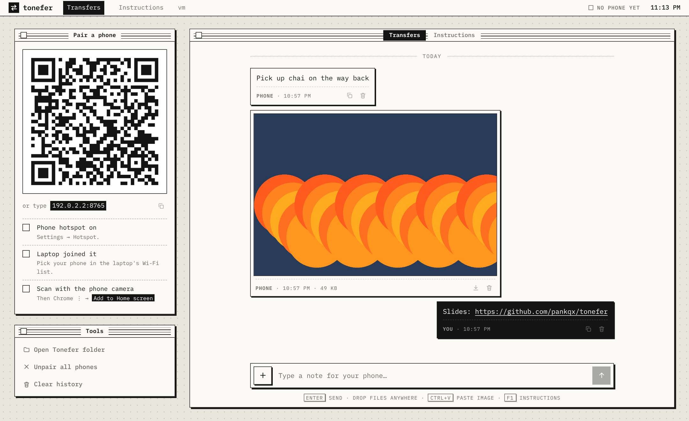
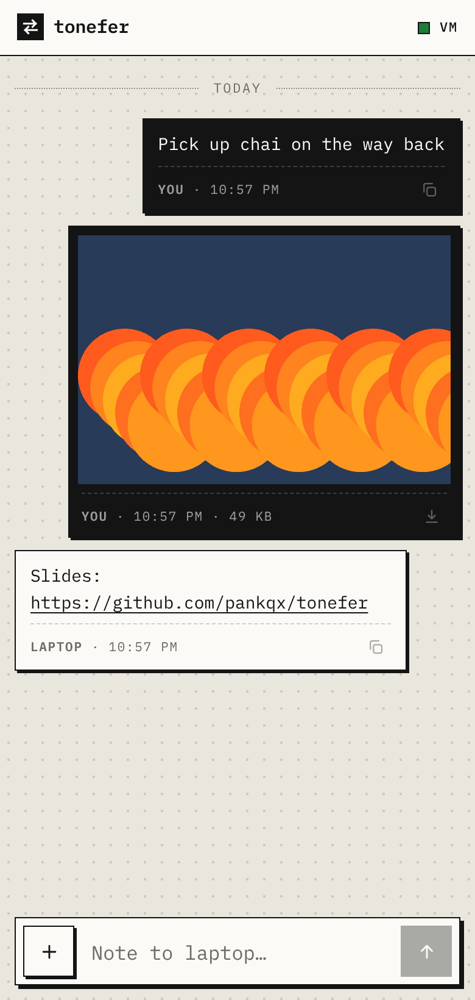
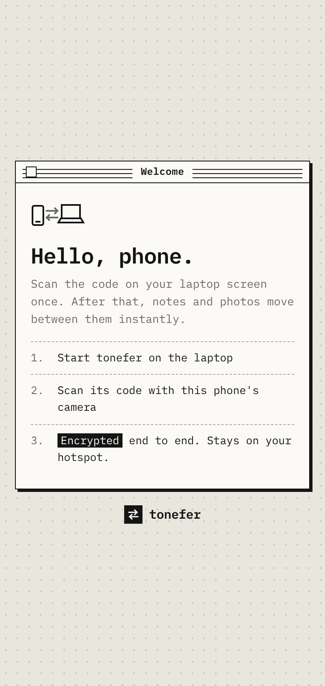

<div align="center">

# Tonefer

**Private, offline transfer between your phone and your laptop.**

Notes, photos and files move instantly over a phone hotspot or USB cable, end-to-end encrypted. No cloud, accounts or internet needed.

[User guide](GUIDE.md) · [Android app](https://github.com/pankqx/tonefer-android) · [Protocol](docs/PROTOCOL.md)



</div>

---

## Why Tonefer

Most phone-to-laptop tools go through someone else's server, need an account, or need Wi‑Fi. Tonefer uses the link you already have: your phone's hotspot or a USB cable. Data travels a few centimetres, encrypted, and never leaves your hands.

| | |
|---|---|
| **Works anywhere** | Phone hotspot, USB tethering or shared Wi‑Fi. Internet isn't needed and local transfers don't use mobile data. |
| **End-to-end encrypted** | One QR scan shares a 256‑bit key. Every payload is sealed with XSalsa20‑Poly1305, and anything that doesn't decrypt is rejected. |
| **One click** | Runs in the background at login, appears in the app launcher, and auto-joins your hotspot. |
| **History** | Every transfer stays in a timeline on both devices until you clear it. |
| **Android app** | *Share → Tonefer* from any app, automatic discovery, background notifications and a full customisation menu. |
| **Built-in help** | An Instructions tab on the laptop (<kbd>F1</kbd>) and a help sheet on the phone. |

<p align="center">
  
  &nbsp;&nbsp;
  
</p>

## Quick start (Ubuntu)

```bash
sudo apt install -y git python3 python3-venv
git clone https://github.com/pankqx/tonefer.git ~/tonefer
cd ~/tonefer && ./scripts/install-ubuntu.sh --hotspot "Your Hotspot Name"
```

Then open **Tonefer** from the app launcher and scan the code with your phone. The full walkthrough, including Windows, updates and troubleshooting, is in **[GUIDE.md](GUIDE.md)**.

## How it works

```
 Phone (Android app / Chrome)                       Laptop (Python, aiohttp)
 ┌─────────────────────────┐   hotspot · USB · LAN   ┌──────────────────────────┐
 │ seal(payload, key)  ────┼────── HTTP / WebSocket ─┼──▶ open(payload, key)     │
 │ open(payload, key)  ◀───┼─────────────────────────┼──── seal(payload, key)   │
 └─────────────────────────┘                         │ history · ~/Tonefer files │
         ▲  key shared once via QR (#fragment)        └──────────────────────────┘
```

- **Pairing:** the laptop generates a 32-byte key and shows it in a QR link's `#fragment`. Browsers never send the fragment to a server.
- **Transport:** plain HTTP/WebSocket on the local network. Every body and frame is a NaCl `secretbox`, so the transport itself carries only ciphertext.
- **Laptop view:** served on `127.0.0.1` only, with a `Host` check against DNS rebinding.
- **Discovery:** the Android app finds the laptop by probing its own network interfaces with the pairing token. No mDNS or broadcast permissions needed.

## Project layout

```
server.py              Laptop app: pairing, encryption, history, routes
netinfo.py             Address selection, Wi‑Fi name, firewall detection, doctor
web/desk/              Laptop interface (Transfers · Instructions)
web/phone/             Phone web interface
web/static/            Shared CSS/JS, tweetnacl, IBM Plex Mono (all offline)
scripts/               One-click install / uninstall / launcher (Ubuntu)
docs/PROTOCOL.md       Wire protocol (used by the Android app)
```

Configuration (environment variables): `TONEFER_PORT` (8765), `TONEFER_FILES` (`~/Tonefer`) and `TONEFER_HOME` (`~/.tonefer`).

## Security notes

- The key is stored in `~/.tonefer/pairing.key` (mode 600). **Unpair all phones** rotates it immediately.
- The phone *web* view loads its code over local HTTP, so someone already on your hotspot could tamper with that page. Keep your hotspot password-protected, or use the Android app, which ships its code inside the app.

## Roadmap

- [x] Encrypted notes, photos and files with history
- [x] One-click Ubuntu setup: background service, launcher, hotspot auto-join
- [x] Instructions tab and phone help
- [x] Native Android app with share target and customisation
- [ ] Windows installer (single `.exe`)
- [ ] Chunked streaming for very large files
- [ ] Clipboard sync (quick-settings tile)

---

<sub>© 2026 Pank. Built with Python, aiohttp, PyNaCl and tweetnacl-js.</sub>
